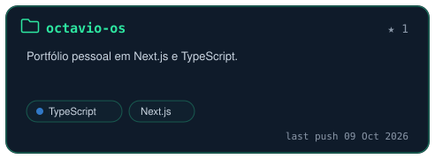
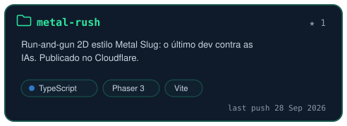
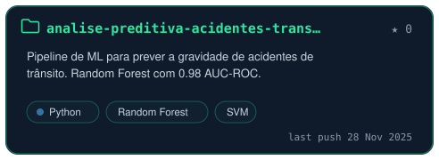
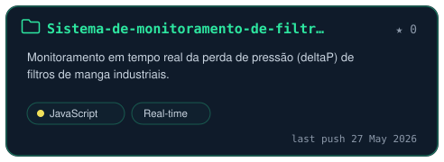
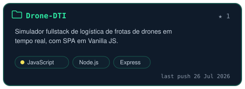
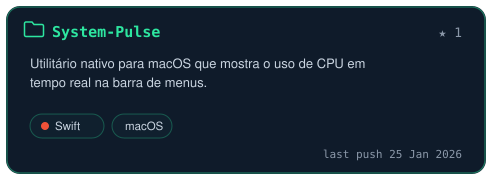

<div align="center">

<a href="https://octavio-os2-0.vercel.app" target="_blank"></a>

</div>

### About

```text
                                    ⢀⣀⡀⠀⠀⠀⠀⠀⠀⠀⠀⠀⠀⠀⠀⣀⣤⣤⣀⠀⠀⠀⠀⠀⠀⠀⠀⠀⠀⠀⠀⠀⠀
                                    ⠀⠀⠀⠀⠀⡀⣰⡿⠛⠛⠿⢶⣦⣀⠀⢀⣀⣀⣀⣀⣠⡾⠋⠀⠀⠹⣷⣄⣤⣶⡶⠿⠿⣷⡄⠀⠀⠀⠀⠀
                                    ⠀⠀⠀⠀⠀⢰⣿⠁⠀⠀⠀⠀⠈⠙⠛⠛⠋⠉⠉⢹⡟⠁⠀⠀⣀⣀⠘⣿⠉⠀⠀⠀⠀⠘⣿⠀⠀⠀⠀⠀
                                    ⠀⠀⠀⠀⠀⢸⣿⠀⠀⠀⠀⠀⠀⠀⠀⠀⠀⠀⠀⣿⠁⠀⠀⣾⡋⣽⠿⠛⠿⢶⣤⣤⣤⣤⣿⠀⠀⠀⠀⠀
                                    ⠀⠀⠀⠀⠀⢸⣿⡴⠀⠀⠀⠀⠀⠀⠀⠀⠀⠀⠀⢻⣄⡀⠀⢈⣻⡏⠀⠀⠀⠀⣿⣀⠀⠈⠙⣷⠀⠀⠀⠀
                                    ⠀⠀⠀⠀⠀⣰⡿⠁⠀⠀⠀⠀⠀⠀⠀⠀⠀⠀⠀⠀⠙⠛⠛⠛⠙⢷⣄⣀⣀⣼⣏⣿⠀⠀⢀⣿⠀⠀⠀⠀
                                    ⠀⠀⠀⠀⢸⡟⠀⠀⠀⠀⠀⠀⠀⠀⠀⠀⠀⠀⠀⠀⠀⠀⠀⠀⠀⠀⠉⠙⣿⡉⠉⠁⢀⣠⣿⡇⠀⠀⠀⠀
                                    ⠀⠀⠀⠀⣿⠃⠀⠀⠀⠀⠀⠀⠀⠀⠀⠀⠀⠀⠀⠀⠀⠀⠀⠀⠀⠀⠀⠀⠈⠛⠗⠾⠟⠋⢹⣷⠀⠀⠀⠀
                                    ⢀⣤⣤⣤⣿⣤⣄⠀⠀⠀⠴⠚⠲⠄⠀⠀⠀⠀⠀⠀⠀⠀⠀⠀⠀⠀⣠⣶⡆⠀⠀⠀⠀⢀⣈⣿⣀⣀⡀⠀
                                    ⠀⠀⠀⠈⣿⣠⣾⠟⠛⢷⡄⠀⠀⠀⠀⠀⠀⠀⡤⠶⢦⡀⠀⠀⠀⠀⠹⠯⠃⠀⠀⠀⠈⠉⢩⡿⠉⠉⠉⠁
                                    ⠀⠀⣤⡶⠿⣿⣇⠀⠀⠸⣷⠀⠀⠀⠀⠀⠀⠀⠓⠶⠞⠃⠀⠀⠀⠀⠀⠀⠀⠀⠀⠀⠀⢤⣼⣯⣀⣀⠀⠀
                                    ⠀⢰⣯⠀⠀⠈⠻⠀⠀⠀⣿⣶⣤⣄⠀⠀⠀⠀⠀⠀⠀⠀⠀⠀⠀⠀⠀⠀⠀⠀⠀⠀⠀⣰⡿⠁⠉⠉⠁⠀
                                    ⠀⠀⠙⣷⣄⠀⠀⠀⠀⠀⢀⣀⣀⠙⢿⣆⠀⠀⠀⠀⠀⠀⠀⠀⠀⠀⠀⠀⠀⠀⠀⢈⣿⡿⢷⣄⡀⠀⠀⠀
                                    ⠀⠀⠀⠈⠙⣷⠀⠀⠀⣴⠟⠉⠉⠀⠀⣿⣀⣀⠀⠀⠀⠀⠀⠀⠀⠀⢀⣀⣠⣤⣾⠟⠉⠀⠀⠈⠉⠀⠀⠀
                                    ⠀⠀⠀⠀⠰⣿⠀⠀⠀⠙⢧⣤⡶⠟⢀⣿⠛⢟⡟⡯⠽⢶⡶⠾⢿⣻⣏⣹⡏⣁⡿⠀⠀⠀⠀⠀⠀⠀⠀⠀
                                    ⠀⠀⠀⠀⠀⠹⣷⣄⠀⠀⠀⠀⠀⣠⣾⠏⠀⠀⠙⠛⠛⠋⠀⠀⢀⣽⠟⠛⠖⠛⠀⠀⠀⠀⠀⠀⠀⠀⠀⠀
                                    ⠀⠀⠀⠀⠀⠀⠀⠙⠻⠷⠶⠿⠟⠋⠹⣷⣤⣀⡀⠄⣡⣀⣠⣴⡿⠁⠀⠀⠀⠀⠀⠀⠀⠀⠀⠀⠀⠀⠀⠀
                                    ⠀⠀⠀⠀⠀⠀⠀⠀⠀⠀⠀⠀⠀⠀⠀⠈⠳⣍⣉⣻⣏⣉⣡⠞⠁⠀⠀⠀⠀⠀⠀⠀⠀⠀⠀⠀⠀⠀⠀⠀
                                    ⠀⠀⠀⠀⠀⠀⠀⠀⠀⠀⠀⠀⠀⠀⠀⠀⠀⠀⠀⠀⠈⠁⠀⠀⠀⠀⠀⠀⠀⠀⠀⠀⠀⠀⠀⠀⠀⠀⠀⠀

┌──────────────────────────────────────────────────┐  ⠀⠀⠀⠀⠀⠀⠀⠀⠀⠀⠀⠀⠀⠀⠀⠀⠀⠀⠀⠀⠀⠀⠀⠀⠀⠀⠀⠀⠀⠀⠀⠀⢀⣀⣀⣤⣤⣤⣤⣄⣀⣀⠀⠀⠀⠀⠀⠀⠀⠀⠀⠀⠀⠀⠀⠀⠀⠀⠀⠀⠀⠀⠀⠀⠀
│ octavio@github ~ [session: active]               │  ⠀⠀⠀⠀⠀⠀⠀⠀⠀⠀⠀⠀⠀⠀⠀⠀⠀⠀⠀⠀⠀⠀⠀⠀⠀⠀⠀⠀⣀⣤⠶⣻⠝⠋⠠⠔⠛⠁⡀⠀⠈⢉⡙⠓⠶⣄⡀⠀⠀⠀⠀⠀⠀⠀⠀⠀⠀⠀⠀⠀⠀⠀⠀⠀⠀
├──────────────────────────────────────────────────┤  ⠀⠀⠀⠀⠀⠀⠀⠀⠀⠀⠀⠀⠀⠀⠀⠀⠀⠀⠀⠀⠀⠀⠀⠀⠀⠀⣠⠞⢋⣴⡮⠓⠋⠀⠀⢄⠀⠀⠉⠢⣄⠀⠈⠁⠀⡀⠙⢶⣄⠀⠀⠀⠀⠀⠀⠀⠀⠀⠀⠀⠀⠀⠀⠀⠀
│                                                  │  ⠀⠀⠀⠀⠀⠀⠀⠀⠀⠀⠀⠀⠀⠀⠀⠀⠀⠀⠀⠀⠀⠀⠀⠀⣠⠞⢁⣔⠟⠁⠀⠀⠀⠀⠀⠈⡆⠀⠀⠀⠈⢦⡀⠀⠀⠘⢯⢢⠙⢦⡀⠀⠀⠀⠀⠀⠀⠀⠀⠀⠀⠀⠀⠀⠀
│ $ whoami                                         │  ⠀⠀⠀⠀⠀⠀⠀⠀⠀⠀⠀⠀⠀⠀⠀⠀⠀⠀⠀⠀⠀⠀⢀⡼⠃⠀⣿⠃⠀⠀⠀⠀⠀⠀⠀⠀⠸⠀⠀⠀⠀⠀⢳⣦⡀⠀⠀⢯⠀⠈⣷⡀⠀⠀⠀⠀⠀⠀⠀⠀⠀⠀⠀⠀⠀
│                                                  │  ⠀⠀⠀⠀⠀⠀⠀⠀⠀⠀⠀⠀⠀⠀⠀⠀⠀⠀⠀⠀⠀⢀⣾⠆⡄⢠⢧⠀⣸⠀⠀⠀⠀⠀⠀⠀⢰⠀⣄⠀⠀⠀⠀⢳⡈⢶⡦⣿⣷⣿⢉⣷⡀⠀⠀⠀⠀⠀⠀⠀⠀⠀⠀⠀⠀
│ Octávio Augusto · Fullstack Dev · BH, MG, BR     │  ⠀⠀⠀⠀⠀⠀⠀⠀⠀⠀⠀⠀⠀⠀⠀⠀⠀⠀⠀⠀⢠⣿⣯⣿⣁⡟⠈⠣⡇⠀⠀⢸⠀⠀⠀⠀⢸⡄⠘⡄⠀⠀⠀⠈⢿⢾⣿⣾⢾⠙⠻⣾⣧⠀⠀⠀⠀⠀⠀⠀⠀⠀⠀⠀⠀
│ BSc Computer Science - UNA                       │  ⠀⠀⠀⠀⠀⠀⠀⠀⠀⢀⠀⠀⠀⠀⠀⠀⠀⠀⠀⢀⣿⡿⣮⠇⢙⠷⢄⣸⡗⡆⠀⢘⠀⠀⠀⠀⢸⠧⠀⢣⠀⠀⠀⡀⡸⣿⣿⠘⡎⢆⠈⢳⣽⣆⠀⠀⠀⠀⠀⠀⠀⠀⠀⠀⠀
│ Focus: Software Eng. & Data Science              │  ⠀⠀⠀⠀⠀⠀⠀⠀⢠⡟⢻⢷⣄⠀⠀⠀⠀⠀⠀⣾⣳⡿⡸⢀⣿⠀⠀⢸⠙⠁⠀⠼⠀⠀⠀⠀⢸⣇⠠⡼⡤⠴⢋⣽⣱⢿⣧⠀⢳⠈⢧⠀⢻⣿⣧⡀⠀⠀⠀⠀⠀⠀⠀⠀⠀
│                                                  │  ⠀⠀⠀⠀⠀⠀⠀⢀⡿⣠⡣⠃⣿⠃⠀⠀⠀⠀⣸⣳⣿⠇⣇⢸⣿⢸⣠⠼⠀⠀⠀⡇⠀⡀⠉⠒⣾⢾⣆⢟⣳⡶⠓⠶⠿⢼⣿⣇⠈⡇⠘⢆⠈⢿⡘⣷⠀⠀⠀⠀⠀⠀⠀⠀⠀
│ $ cat stack.conf                                 │  ⠀⠀⠀⠀⠀⠀⠀⠈⢷⣍⣤⡶⣿⡄⠀⠀⠀⢠⣿⠃⣿⠀⡏⢸⣿⣿⠀⢸⠀⠀⢠⡗⢀⠇⠀⢠⡟⠀⠻⣾⣿⠀⠀⠀⠀⡏⣿⣿⡀⢹⡀⠈⢦⠈⢷⣿⡆⠀⠀⠀⠀⠀⠀⠀⠀
│                                                  │  ⠀⠀⠀⠀⠀⠀⠀⠀⠀⠈⢁⣤⣄⠁⠀⠀⠀⣼⡏⢰⣟⠀⣇⠘⣿⣿⣾⣾⣆⢀⣾⠃⣼⢠⣶⣿⣭⣷⣶⣾⣿⣤⠀⠀⠀⡇⡯⣍⣧⠀⣷⠄⠈⢳⡀⢻⡁⠀⠀⠀⠀⠀⠀⠀⠀
│ [frontend] HTML · CSS · JS · TS · React          │  ⠀⠀⠀⠀⠀⠀⠀⠀⠀⠀⠺⣿⡿⠀⠀⠀⠀⡿⢀⣾⣧⠀⡗⡄⢿⣿⡙⣽⣿⣟⠛⠚⠛⠙⠉⢹⣿⣿⣦⠀⢸⡿⠀⠀⠀⢰⡯⣌⢻⡀⢸⢠⢰⡄⠹⡷⣿⣦⣤⠤⣶⡇⠀⠀⠀
│ [backend]  Python · Node.js · MySQL · PostgreSQL │  ⠀⠀⠀⠀⠀⠀⠀⠀⠀⠀⠀⠀⠀⢀⠀⠀⠀⣇⣾⣿⢸⢠⣧⢧⠘⣿⡇⠸⣿⢿⡆⠀⠀⠀⠀⠘⣯⠇⣿⠂⣸⢰⠀⠀⢀⣸⡧⣊⣼⡇⢸⣼⣸⣷⢣⢻⣄⠉⠙⠛⠉⠀⠀⠀⠀
│ [data/mob] MATLAB · Swift                        │  ⠀⠀⠀⠀⠀⠀⠀⠀⠀⠀⠀⠀⠀⣿⣳⣤⣴⣿⣏⣿⣾⢸⣿⡘⣧⣘⢿⣀⡙⣞⠁⠀⠀⠀⠀⢀⡬⢀⣉⢠⣧⡏⠀⠀⡎⣿⣿⣿⣿⠃⣸⡏⣿⣿⡎⢿⡘⡆⠀⠀⠀⠀⠀⠀⠀
│ [infra]    Docker · Git · Linux · Nginx          │  ⠀⠀⠀⠀⠀⠀⠀⠀⠀⠀⠀⠀⠀⠈⠉⠉⣠⣼⣿⣿⣿⣼⣿⣧⢿⣿⣿⣯⡻⠟⠀⠀⠀⠀⠀⠐⢯⠣⡽⢟⣽⠀⠀⢘⡇⣿⣿⣿⡟⣴⣿⣷⣿⣿⣧⣿⣷⡽⠀⠀⠀⠀⠀⠀⠀
│                                                  │  ⣀⣀⣀⣀⣀⣀⣀⣀⣀⣀⣀⣀⣀⣀⣀⣼⣹⣿⣇⣸⣿⣿⣿⣻⣚⣿⡿⣿⣿⣦⣤⣀⡉⠃⠀⢀⣀⣤⡶⠛⡏⠀⢀⣼⢸⣿⣿⣿⣿⣿⣿⣿⢋⣿⣿⣿⣿⡇⠀⠀⠀⠀⠀⠀⠀
│ $ cat portfolio.txt                              │  ⣿⠛⠛⠛⠛⠛⠛⠛⠛⠛⠛⠛⠛⠛⠛⠛⠛⠛⠛⠛⠛⠛⠒⠒⠒⢭⢻⣽⣿⣿⣿⣿⣿⣿⢿⠿⣿⡏⠀⡼⠁⣀⣾⣿⣿⣿⣿⡿⣿⣿⣟⡻⣿⣿⡿⠣⠟⠀⠀⠀⠀⠀⠀⠀⠀
│                                                  │  ⠸⡆⠀⠀⠀⠀⠀⠀⠀⠀⠀⠀⠀⠀⠀⠀⠀⠀⠀⠀⠀⠀⠀⠀⠀⠈⢧⢿⣯⡽⠿⠛⠋⣵⢟⣋⣿⣶⣞⣤⣾⣿⣿⡟⢉⡿⢋⠻⢯⡉⢻⡟⢿⡅⠀⠀⠀⠀⠀⠀⠀⠀⠀⠀⠀
│ (https://octavio-os2-0.vercel.app) to see:       │  ⠀⢻⡄⠀⠀⠀⠀⠀⠀⠀⠀⠀⠀⠀⠀⠀⠀⠀⠀⠀⠀⠀⠀⠀⠀⠀⠘⡞⣿⣆⡀⠀⡼⡏⠉⠚⠭⢉⣠⠬⠛⠛⢁⡴⣫⠖⠁⠀⠀⣩⠟⠁⣸⣇⠀⠀⠀⠀⠀⠀⠀⠀⠀⠀⠀
│ - Scalable Fullstack applications & APIs         │  ⠀⠈⢷⠀⠀⠀⠀⠀⠀⠀⠀⠀⠀⠀⠀⠀⠀⠀⠀⠀⠀⠀⠀⠀⠀⠀⠀⢹⣽⣿⣿⣾⠳⡙⣦⡤⠜⠊⠁⠀⣀⡴⠯⠾⠗⠒⠒⠛⠛⠛⠛⠛⠓⠿⣦⡀⠀⠀⠀⠀⠀⠀⠀⠀⠀
│ - Industrial monitoring systems (0.98 AUC-ROC)   │  ⠀⠀⠘⣧⠀⠀⠀⠀⠀⠀⠀⠀⠀⠀⠰⣄⡀⠀⠀⠀⠀⠀⠀⠀⠀⠀⠀⠀⢷⣻⣿⣿⠔⢪⠓⠬⢍⠉⣩⣽⢻⣤⣶⣦⠀⠀⠀⢀⣀⣤⣴⣾⣿⣿⣿⣿⠀⠀⠀⠀⠀⠀⠀⠀⠀
│ - Data-driven solutions & Software Architecture  │  ⠀⠀⠀⠹⡆⠀⠀⠀⠀⠀⠀⠀⠀⠀⣰⣾⡏⢦⠀⠀⠀⠀⠀⠀⠀⠀⠀⠀⠘⣯⣿⣿⠀⠀⣇⠀⣠⠎⠁⢹⡎⡟⡏⣷⣶⠿⠛⡟⠛⠛⣫⠟⠉⢿⣿⡿⠀⠀⠀⠀⠀⠀⠀⠀⠀
│                                                  │  ⠀⠀⠀⠀⢻⡄⠀⠀⠀⠀⠀⠀⠀⠀⠹⣿⣷⠈⢷⡤⠀⠀⠀⠀⠀⠀⠀⠀⠀⢹⣾⣷⡀⣀⣀⣷⡅⠀⠀⠈⣷⢳⡇⣿⠀⠀⣸⠁⢠⡾⣟⣛⣻⣟⡿⣇⠀⠀⠀⠀⠀⠀⠀⠀⠀
│ $ cat hobbies.txt                                │  ⠀⠀⠀⠀⠀⢷⡀⠀⠀⠀⠀⠀⠀⠀⠀⠀⠀⠀⠀⠀⠀⠀⠀⠀⠀⠀⠀⠀⠀⠀⢯⢻⣏⡵⠿⠿⢤⣄⠀⢀⣿⢸⣹⣿⣀⣴⣿⣴⣿⣛⠋⠉⠉⡉⠛⣿⣧⡀⠀⠀⠀⠀⠀⠀⠀
│                                                  │  ⠀⠀⠀⠀⠀⠘⣧⠀⠀⠀⠀⠀⠀⠀⠀⠀⠀⠀⠀⠀⠀⠀⠀⠀⠀⠀⠀⠀⠀⠀⠈⡎⣿⣥⣶⠖⢉⣿⡿⣿⣿⡿⣿⣟⠿⠿⣿⣿⣿⡯⠻⣿⣿⣿⣷⡽⣿⡗⠀⠀⠀⠀⠀⠀⠀
│ ML · gaming · anime · mountain biking            │  ⠀⠀⠀⠀⠀⠀⠸⣇⠀⠀⠀⠀⠀⠀⠀⠀⠀⠀⠀⠀⠀⠀⠀⠀⠀⠀⠀⠀⠀⠀⠀⠸⡘⣿⣩⠶⣛⣋⡽⠿⣷⢬⣙⣻⣿⣿⣿⣯⣛⠳⣤⣬⡻⣿⣿⣿⣿⣧⠀⠀⠀⠀⠀⠀⠀
│                                                  │  ⠀⣿⣛⣻⣿⡿⠿⠟⠗⠶⠶⠶⠶⠤⠤⢤⠤⡤⢤⣤⣤⣤⣤⣄⣀⣀⣀⣀⣀⣀⣀⣀⣣⢹⣷⣶⣿⣿⣦⣴⣟⣛⣯⣤⣿⣿⣿⣿⣿⣷⣌⣿⣿⣿⣿⣿⣿⣿⣤⣤⣤⣤⣤⣤⣄
│ $ _                                              │  ⠀⠉⠙⠛⠛⠛⠛⠛⠻⠿⠿⠿⠷⠶⠶⢶⣶⣶⣶⣶⣤⣤⣤⣤⣤⣥⣬⣭⣭⣉⣩⣍⣙⣏⣉⣏⣽⣶⣶⣶⣤⣤⣬⣤⣤⣾⣿⠶⠾⠿⠿⠿⠿⠛⠛⠛⠛⠛⠛⠛⠛⠛⠛⠛⠃
└──────────────────────────────────────────────────┘  ⠀⠀⠀⠀⠀⠀⠀⠀⠀⠀⠀⠀⠀⠀⠀⠀⠀⠀⠀⠀⠀⠀⠀⠀⠈⠉⠉⠉⠉⠉⠉⠛⠛⠛⠛⠛⠛⠋⠉⠉⠉⠉⠀⠀⠀⠀⠀⠀⠀⠀⠀⠀⠀⠀⠀⠀⠀⠀⠀⠀⠀⠀⠀⠀⠀

```

<div align="center">





</div>

### Featured Projects

<p align="center">
  <a href="https://github.com/SecreTavin/octavio-os"></a>
  <a href="https://github.com/SecreTavin/metal-rush"></a>
  <a href="https://github.com/SecreTavin/analise-preditiva-acidentes-transito-V2"></a>
  <a href="https://github.com/SecreTavin/Sistema-de-monitoramento-de-filtros-de-manga-industriais"></a>
  <a href="https://github.com/SecreTavin/Drone-DTI"></a>
  <a href="https://github.com/SecreTavin/System-Pulse"></a>
</p>

---

###  Connect with me:

<p align="left">
  <a href="https://octavio-os2-0.vercel.app" target="_blank"></a>

  
  <a href="https://linkedin.com/in/octavio-prazeres" target="blank"></a>

  
  <a href="mailto:arrudaoctavio178@gmail.com"></a>
</p>
